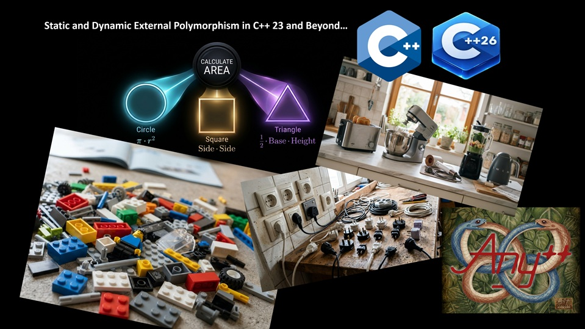

\page talk_meeting_cpp26 Talk at Meeting C++ 2026: Static and Dynamic Polymorphism in C++23 and beyond

### [Video](https://youtu.be/hr_AGfIAInk)

### [Slides](https://github.com/bitfactory-software/anyxx/blob/master/docs/TalkMeetingCpp26.pdf?raw=true)

- [Download now!](https://github.com/bitfactory-software/anyxx/blob/master/docs/TalkMeetingCpp26.pdf?raw=true)

### Examples
- \subpage  talk_meeting_cpp26_sample_01_                                     
- \subpage  talk_meeting_cpp26_sample_01_ptr                                  
- \subpage  talk_meeting_cpp26_sample_01_ref                                  
- \subpage  talk_meeting_cpp26_sample_01_val                                  
- \subpage  talk_meeting_cpp26_sample_02_shared_weak                          
- \subpage  talk_meeting_cpp26_sample_03_any                                  
- \subpage  talk_meeting_cpp26_sample_04_functiom                             
- \subpage  talk_meeting_cpp26_sample_05_view                                 
- \subpage  talk_meeting_cpp26_sample_06_trait_as                             
- \subpage  talk_meeting_cpp26_sample_07_downcast                             
- \subpage  talk_meeting_cpp26_sample_08_crosscast                            
- \subpage  talk_meeting_cpp26_sample_08_factory_and_crosscast                            
- \subpage  talk_meeting_cpp26_sample_09_no_visitors                          
- \subpage  talk_meeting_cpp26_sample_10_spaceship                            
- \subpage  talk_meeting_cpp26_sample_11_vany                                 
- \subpage  talk_meeting_cpp26_sample_12_fancy_expression_tree                

